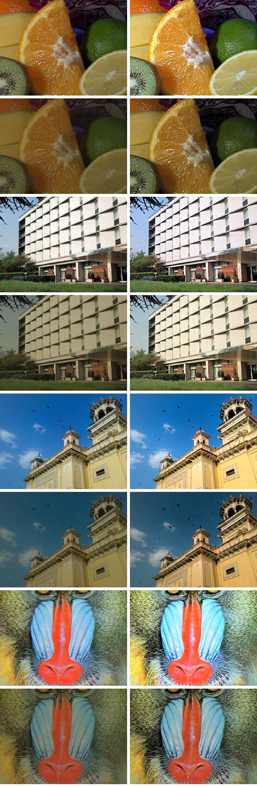

# Architecture and design notes

## The pieces

```
 Guest phone (browser)                GitHub Pages (static, free)            Google (free tier, your account)
 ┌───────────────────────┐   HTML/JS  ┌──────────────────────────┐          ┌──────────────────────────────┐
 │ cam.html              │◀──────────│ site/  (no build, no CDN) │          │ Apps Script web app (Code.gs)│
 │  camera → film look → │           └──────────────────────────┘          │  • auth: admin/host/guest     │
 │  IndexedDB queue ─────┼──── POST text/plain JSON ───────────────────────▶│  • validate, strip EXIF, hash │
 └───────────────────────┘                                                  │  • Drive: one folder / event  │
 TV / album / host / admin ── same API ────────────────────────────────────▶│  • Sheets: index + per event  │
                                                                            └──────────────────────────────┘
 archive.html (Kondor) / scripts/archive-album.mjs ── sign ──▶ Koinos: PhotoShare contract
 recover.html / scripts/recover.mjs ◀──── read-only ───────── (registry, fingerprint, keepsakes)
```

- **Why Apps Script?** It's the only common free option that accepts anonymous uploads with no credit card, stores them in storage you own, and needs no server to babysit. Cloudflare R2 (10 GB free) is faster but requires a card on file. Supabase's free tier pauses inactive projects. Firebase Storage now requires a billing account.
- **Why Sheets?** A free, inspectable database you already own. One index spreadsheet lists events; each event has its own spreadsheet (media and guests), so a big wedding never slows down the others.
- **Why text/plain POST?** Apps Script can't answer CORS preflight requests. A `text/plain` body keeps the request "simple", and Apps Script returns `Access-Control-Allow-Origin: *` on JSON output.

## Request flow: one photo

1. The guest taps the shutter. The frame is drawn to a canvas (≤ 2560 px), the film look is applied as pixel math, the date stamp is added, and it's encoded as JPEG (which drops all EXIF/GPS). A 1024 px preview is made too.
2. Both go into IndexedDB with a random `clientId`, and the counter drops immediately.
3. The uploader sends queued items one at a time with exponential backoff, resuming when the phone is back online or the page is reopened.
4. The backend authenticates the guest token, checks timing, pause, block and rate limits, and reserves a shot under a lock (refunded if Drive fails). It checks magic bytes, strips JPEG metadata, saves both files, sets sharing, records the SHA-256, and bumps the album version.
5. TV and album poll `list` with the last version string. Unchanged albums answer instantly.

## What we took from PartyCam, and what we changed

**Kept, because it works:**
- QR code → browser camera, no app, no guest accounts.
- A limited roll per guest, film looks baked in at capture, and a reveal-after option.
- A TV mode with a QR code beside the photos, a "last call" before close, and replays when quiet.
- Instant hide on guest report, with the host deciding; host pause and delete.

**Improved:**
| PartyCam | PhotoShare |
|---|---|
| Paid tiers by guest count ($15–$150) | $0 at any size; limits are yours to set |
| Vague shot counts ("25 or more") | Exact, host-set shots per guest |
| Weak-signal behaviour undocumented | Offline-first queue; photos never lost |
| Retention unclear; data on their servers | Files in your Drive; you decide when to delete |
| Unclear who counts as a "guest spot" | Only guests who actually upload count toward the limit |
| No way to prove authenticity | SHA-256 per original + optional on-chain fingerprint |
| Automatic NSFW blocking (accuracy unstated) | Approval mode (reliable) + reports + guest blocking. A classifier was left out: it needs a ~6 MB model on every phone and can be bypassed by a modified client |

## Scaling into a planning business

- **Studios:** each Google account that deploys the backend is a studio with its own storage. A Workspace account gives each planner pooled storage, and you add more studios to `config.js` as you grow. Event links carry `?s=studio`.
- **Handing events to clients:** create the event from `admin.html` and give the couple the host link. They moderate; you keep the admin key. "New host link" revokes access after the event.
- **Branding per event:** name, welcome note, accent colour, film look and date stamp.
- **White-label:** change `appName` in `config.js`, the tokens in `app.css`, and `assets/img/icon.svg`. Use a custom domain in GitHub Pages.
- **Volume:** the backend's main limit is Apps Script concurrency (about 30 simultaneous requests per account). The offline queue absorbs bursts. For several large events at once, split them across studios (accounts).
- **Koinos for clients:** register each event under the studio's address and send the couple the recovery link (`recover.html?o=…&e=…`) and the manifest. It's a permanent, verifiable record of their day.

## Enhance

The album's **Enhance** toggle runs `enhance()` in `site/assets/js/film.js` on the viewer's device, using the full-size original. It adapts to each photo:
- **Levels:** a robust black and white point stretch, with the gain capped.
- **Brightness:** a midtone gamma correction.
- **White balance:** a mild correction from the midtones (capped ±10%).
- **Local contrast:** an unsharp mask on luminance.
- **Vibrance:** boosts muted colours more than saturated ones.

Dull or dark photos improve clearly, and good photos change very little. Originals are never modified.



## Possible next steps

- **IPFS second copy:** pin originals to a free IPFS pinning tier or your own node, and store the CID next to the hash.
- **Optional on-device classifier:** load NSFW.js only for hosts who opt in, with a clear download size warning.
- **Guestbook:** short text or audio notes using the same upload path.
- **Printed QR place cards** with per-table labels (the `label` field already exists on guests).
